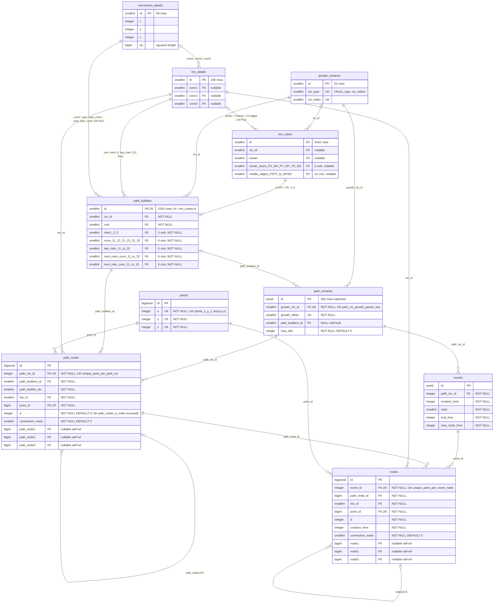

# QSM database tables (from `m3db.TableDefinition` usages)

The column lists below are the reference for the Rust Iceberg tables in `m3data`. Static reference tables are built in memory and are not written. `points`, `path_contexts`, `path_nodes`, `events`, and `nodes` are Parquet files with an Iceberg metadata index under `data/<simulation name>/`. One simulation folder is one space: space parameters live in `inputs.json`, not in a table. See [Iceberg layout](#iceberg-layout).

Source of the column list: freddy33/qsm-go, branch `prod` @ e2be02a (the `rust` branch has the same definitions). Registry: [backend/m3db/m3table.go](https://github.com/freddy33/qsm-go/blob/prod/backend/m3db/m3table.go). The Go code still creates those tables in a Postgres schema `qsm<envId>` (see [m3db.go](https://github.com/freddy33/qsm-go/blob/prod/backend/m3db/m3db.go)). The Rust workspace does not.

| Table | Go package / file | Rows | Purpose |
|---|---|---|---|
| connection_details | pointdb · [m3conndb.go](https://github.com/freddy33/qsm-go/blob/prod/backend/pointdb/m3conndb.go) | 50 | The 50 unit connection vectors (x,y,z) with squared length ds. |
| trio_details | pointdb · [m3conndb.go](https://github.com/freddy33/qsm-go/blob/prod/backend/pointdb/m3conndb.go) | 200 | The 200 trios, each made of 3 connections. |
| growth_contexts | pointdb · [m3growthctxdb.go](https://github.com/freddy33/qsm-go/blob/prod/backend/pointdb/m3growthctxdb.go) | 52 | Growth contexts identified by (ctx_type, ctx_index). |
| trio_cubes | pointdb · [m3triocubedb.go](https://github.com/freddy33/qsm-go/blob/prod/backend/pointdb/m3triocubedb.go) | 5192 | Per-context cube of trios: center, 6 face centers, 12 edge middles. |
| path_builders | pointdb · [m3pathbuilderdb.go](https://github.com/freddy33/qsm-go/blob/prod/backend/pointdb/m3pathbuilderdb.go) | 5192 | Path-builder rules for each trio cube (1:1 with trio_cubes): root trio, intermediate trios, connections. |
| points | pathdb · [pathdb.go](https://github.com/freddy33/qsm-go/blob/prod/backend/pathdb/pathdb.go) | open | Unique 3D integer lattice points. |
| path_contexts | pathdb · [pathdb.go](https://github.com/freddy33/qsm-go/blob/prod/backend/pathdb/pathdb.go) | 200 | A growth context + offset, bound to its path builder, with max distance reached. |
| path_nodes | pathdb · [pathdb.go](https://github.com/freddy33/qsm-go/blob/prod/backend/pathdb/pathdb.go) | open | Nodes of a growth path: point, trio, distance d, links to up to 3 neighbour path nodes. |
| events | spacedb · [spacedb.go](https://github.com/freddy33/qsm-go/blob/prod/backend/spacedb/spacedb.go) | open | An event at a creation time, with a color, growing along one path context. |
| nodes | spacedb · [spacedb.go](https://github.com/freddy33/qsm-go/blob/prod/backend/spacedb/spacedb.go) | open | Event nodes in space-time: a path node placed at a creation time, linked to up to 3 other nodes. |

Go Postgres still has a `spaces` table and `events.space_id` (see `backend/spacedb/spacedb.go`). Rust does not. A folder is the space, and its limits live in `inputs.json`.

## Diagram





- `qsm-db.mmd`: Mermaid ER diagram source (GitHub renders it inline below)
- `qsm-db.svg`: rendered diagram
- `qsm-db.puml`: PlantUML version

Grouped rows in `trio_cubes` and `path_builders` (e.g. "6 cols") stand for repeated FK columns; edge labels list them.

## Notes for the Rust migration

1. `TableDefinition.Indexes` is declared for `events` (3), `nodes` (3) and `path_nodes` (1, on `d`) but `m3table.go` never executes it, so those indexes are never created.
2. Denormalized data with no DB consistency check: `nodes.trio_id`/`nodes.point_id` duplicate what `nodes.path_node_id -> path_nodes` gives; `path_builders.ctx_id` duplicates `trio_cubes.ctx_id`; nothing checks a node's path node belongs to its event's `path_ctx_id`.
3. Uneven nullability: FKs in `trio_details`/`trio_cubes` (and `connection_details` x/y/z/ds) are nullable while the matching `path_builders` columns are NOT NULL.
4. Mixed-case column names like `center_faces_PX` are unquoted, so Postgres stores them lowercase.
5. Typo: Go function `creatPathNodesTableDef`.

## Iceberg layout

Rust storage uses the `iceberg` crate 0.10 (apache/iceberg-rust) for table metadata and the `arrow` and `parquet` crates 58.4 (arrow-rs) for the data files. There is no catalog service, no Postgres, and no network. Each simulation is a local warehouse at `data/<simulation name>/`.

iceberg-rust 0.10 has no filesystem catalog. The process opens a memory catalog whose warehouse is `file://<absolute data/<simulation name>>` and whose storage is the local filesystem. Creating a table writes `qsm/<table>/metadata/00000-<uuid>.metadata.json`. A later process does not trust the in-memory index: it scans that metadata directory, picks the highest zero-padded version, and registers that file. The latest `*.metadata.json` is the durable commit pointer.

Namespace: `qsm`. Format version: 2. Ids are assigned in Rust (`max(id) + 1`, starting at 1). Iceberg does not enforce primary keys, foreign keys, or unique constraints. Before each append, Rust rejects a non-positive id and any repeat of:

- `points` `(x, y, z)` and `id`
- `path_contexts` `(growth_ctx_id, growth_offset)` and `id`
- `path_nodes` `(path_ctx_id, point_id)` and `id`
- `events` `id`
- `nodes` `(event_id, point_id)` and `id`

A growth step has to change connection masks and cursors on rows that already exist. iceberg-rust 0.10 transactions only offer fast append, so Rust appends a new copy of that path node, path context, or event with the **same id** and the same natural key. Load keeps one row per id: for a path node, the copy with fewer `NotSet` connections (then more assigned links); for a path context, the higher `max_dist`; for an event, the higher `max_node_time`. A different id that collides on the natural key is still rejected. Points and event nodes are insert-only.

Postgres `smallint`, `integer`, and `serial` columns are Iceberg `int` (32-bit). `bigserial` / `bigint` are `long`. `varchar` is `string`. Nullable columns stay optional. The `id` column is field id 1 and is the Iceberg identifier field. Other field ids follow the column order in the diagram above.

### Tables

| Table | Stored | Partition spec | Why |
| --- | --- | --- | --- |
| `connection_details`, `trio_details`, `growth_contexts`, `trio_cubes`, `path_builders` | no | — | Derived. `PointPackData::shared()` rebuilds the 50 / 200 / 52 / 5192 / 5192 rows at startup. |
| `points` | yes | unpartitioned | Resume loads the whole point map to enforce `(x, y, z)`. The table is the dimension table for every node. |
| `path_contexts` | yes | unpartitioned | One row per growth context and offset. A run keeps a handful, and resume needs all of them. |
| `path_nodes` | yes | `identity(path_ctx_id)`, `truncate(d, 8)` as `d_bucket` | A step writes one distance. Identity on `d` would add a partition per distance. Width 8 matches growth type 8, the widest permutation, so one band is one permutation cycle. |
| `events` | yes | unpartitioned | A run keeps a handful of events. One folder is one space, so there is no `space_id` to partition on. |
| `nodes` | yes | `identity(event_id)`, `truncate(creation_time, 8)` as `creation_time_bucket` | Same band width as `d`. A step appends the nodes for one creation time into the current band. |

`truncate` uses the Iceberg rule `v - (v % W)` with a positive remainder. Distances 0..7 share `d_bucket=0`; 8..15 share `d_bucket=8`; `-1` lands in `-8`.

An append builds one Arrow `RecordBatch` per partition value and commits those files as one snapshot. A simulation step therefore commits one snapshot per table it changes, not one file per row. Iceberg has no cross-table transaction, so the step's tables are committed one after another: points, path contexts, path nodes, event nodes, then events.

Nullable link columns follow `GetLinkIdsForDb`. `NotSet`, `Blocked`, and a `Next` that is not assigned yet are NULL. `From`, and a `Next` that already has an id, store that positive id. The connection state itself lives in `connection_mask`, so a NULL link is not ambiguous on read. Event nodes copy the path-node mask at the time they are created. Go's `getNodeLinkIds` does not point an event `Next` at the following node, and a new shell has no `Next` yet, so event `node1/2/3` are either NULL or the earlier event node on a `From` link.

`inputs.json` sits next to `qsm/` and is not a table. It holds `max_time_steps`, the space parameters, explicit events, and shortcuts such as `pyramid`. The run grows until every event's max creation time reaches `max_time_steps`. Resume uses the nodes already stored and the max from that file.

After a successful `qsm <name>`, Rust writes `qsm/run-<YYYYMMDDTHHMMSSZ>.json` (UTC). The file records the sha256 of the raw `inputs.json`, the parsed inputs, the resolved space parameters, the event list after shortcut expansion, the `max_time_steps` used, and the last saved creation time. The next run of that name loads the latest `run-*.json` (lexical order; a same-second file is `run-<stamp>_01.json`, which sorts after the unsuffixed name). Space parameters and expanded events must match. Only `max_time_steps` may change. Any other difference is an error and writes nothing. Saved rows with no `run-*.json` are an error too. The `doc` string is not part of that check.

### Folder tree

```text
data/<simulation name>/
├── inputs.json
└── qsm/
    ├── run-20261022T121800Z.json
    ├── points/
    │   ├── data/part-<n>-<pid>-<seq>.parquet
    │   └── metadata/
    │       ├── 00000-<uuid>.metadata.json
    │       ├── 00001-<uuid>.metadata.json    # one new file per commit
    │       └── snap-<id>-<m>.avro            # manifest list, plus the manifest
    ├── path_contexts/
    ├── path_nodes/
    │   └── data/path_ctx_id=<id>/d_bucket=<n>/part-<n>-<pid>-<seq>.parquet
    ├── events/
    │   └── data/part-<n>-<pid>-<seq>.parquet
    └── nodes/
        └── data/event_id=<id>/creation_time_bucket=<n>/part-<n>-<pid>-<seq>.parquet
```

`00000-*.metadata.json` is the empty table. Each batch append writes the next version and its Avro manifest list. Opening the folder registers the highest version. `data/` at the repository root is gitignored, and so is `rust/data/` when the CLI is run from `rust/`.
