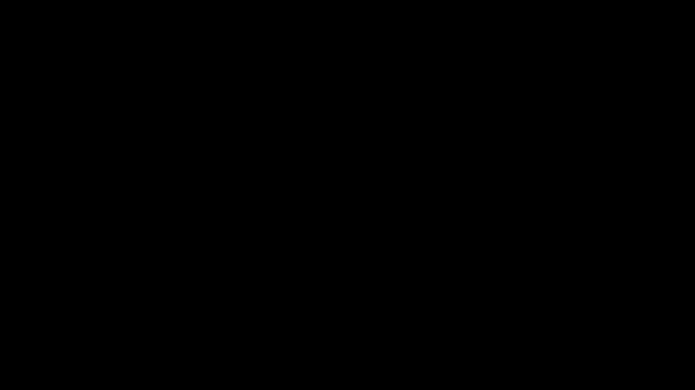

# QSM in Rust

Rust implementation of the Quantum State Machine: a 3D integer-lattice cellular automaton. This directory is the Cargo workspace. The algorithms follow the original Go code, which is no longer in the tree.

Lattice coordinates, connection ids, trio indexes, growth contexts, cube keys, and path steps stay integers, as in the Go code. The one formula that uses `float32` in Go, the predicted path size, is kept as `f32` and truncated toward zero the same way.

Derived counts match the Go tests:

| data | count |
| --- | ---: |
| connections | 50 |
| trios | 200 |
| growth contexts | 52 |
| trio cubes | 5192 |
| path builders | 5192 |

Storage layout: [docs/db/README.md](../docs/db/README.md).

## Crates

| crate | Go source | what it does |
| --- | --- | --- |
| `m3util` | `m3util` | environment ids `0..16`, positive moduli, bit count, errors |
| `m3point` | `model/m3point`, `backend/pointdb` | points, connections, base trios, valid-next and mod-4/mod-8 permutations, growth contexts, trio cubes, path builders, murmur point map |
| `m3path` | `model/m3path`, `backend/pathdb` | 4-bit connection state, path-context growth, event link ids, predicted size |
| `m3space` | `model/m3space`, `backend/spacedb` | event colors, active-link threshold, three-id groups, index rows, pyramids |
| `m3data` | `backend/m3db`, `backend/pathdb`, `backend/spacedb` | `inputs.json`, event growth, and local Iceberg tables of Parquet files |
| `qsm` | `backend` entry point | `qsm <simulation name>` reads `inputs.json` and grows up to its max time. `qsm <name> --new` writes that file from `simulation-configs/<name>-config.json` |
| `m3gl` | `ui/m3gl` | drawing filters, colors, dimmers, and object types |
| `playgl` | `ui/playgl` | prints the static pack counts |
| `qsm-view` | `ui/m3gl`, `ui/playgl` | Bevy window: `qsm-view <simulation name>` |

`PointPackData::shared()` builds the static reference pack once (connections, trios, growth contexts, trio cubes, path builders). Those tables are not written. `playgl` prints the counts above. The window is `qsm-view`.

## Simulation data

`qsm <simulation name>` creates `data/<simulation name>/` under the current directory, or resumes that folder. `QSM_DATA_ROOT` overrides the `data` directory.

```bash
cd rust
cargo run -p qsm -- my-sim
QSM_DATA_ROOT=/tmp/qsm cargo run -p qsm -- my-sim
```

The initial state is `data/<simulation name>/inputs.json`. A new folder with no file and no saved rows gets the default below, then the run starts. A later invocation reads the same file and grows from the last saved creation time until `max_time_steps`. It does not rewrite `inputs.json`.

`qsm <name> --new` does not resume. It reads [`simulation-configs/<name>-config.json`](../simulation-configs/README.md), fills the defaults below, and writes that complete `inputs.json`. If `data/<name>/` already exists, it is renamed to `data/<name>-<YYYYMMDDTHHMMSSZ>/` (UTC; a same-second collision is `_01`) and left untouched. A missing config is an error, and the existing folder stays where it is. `QSM_CONFIG_ROOT` selects the config directory. `./run run <name> --new` sets it to the repository `simulation-configs/`.

```bash
cargo run -p qsm -- pyramid --new
QSM_CONFIG_ROOT=../simulation-configs cargo run -p qsm -- pyramid-size2 --new
```

One simulation name is one space. There is no `spaces` table. After a successful run, `qsm` writes `data/<name>/qsm/run-<YYYYMMDDTHHMMSSZ>.json` (UTC, so the names sort in time order). The next run of that name loads the latest `run-*.json` and compares it with the current `inputs.json`. Resolved space parameters and the event list (shortcuts and explicit events, compared after expansion) must be identical. Only `max_time_steps` may change, and a value below the saved creation time is an error: nothing is written and no new run file is created. Any other difference is an error and writes nothing. Saved rows with no `run-*.json` are an error as well. A same-second collision is `run-<stamp>_01.json`, which sorts after the unsuffixed name and before the next second. The `doc` field is a note and is not part of the check. Raising `max_time_steps` resumes from the last saved creation time.

`max_time_steps` is the last creation time to store. Events created at time 0 contribute their root nodes at time 0, then one shell per later time. `3` therefore stores times 0, 1, 2, and 3.

```json
{
  "doc": "Default is the playgl pyramid.",
  "max_time_steps": 3,
  "space": {
    "active_path_node_threshold": 3,
    "max_trios_per_point": 2,
    "max_path_nodes_per_point": 4,
    "max_coord": 18
  },
  "events": [],
  "shortcuts": [
    {
      "pyramid": {
        "size": 4,
        "growth_type": 8,
        "growth_index": 0,
        "offsets": [0, 2, 4, 6],
        "creation_time": 0
      }
    }
  ]
}
```

An explicit event uses the Go `CreateEvent` fields. `color` is 1 red, 2 green, 4 blue, 8 yellow:

```json
{
  "x": 0,
  "y": 0,
  "z": 0,
  "creation_time": 0,
  "color": 1,
  "growth_type": 8,
  "growth_index": 0,
  "growth_offset": 0
}
```

`events` are created as written, then each shortcut is expanded. The only shortcut today is `pyramid`, matching `CreatePyramidWithParams` in `ui/m3gl/m3gl.go` (and the same four calls in `backend/spacedb/pyramid.go`). playgl calls it with size 4, growth type 8, index 0, and offsets 0, 2, 4, 6 when the world has no events. The four centers are `{3,0,3}`, `{-3,3,3}`, `{-3,-3,3}`, `{0,0,-3}` multiplied by `size`, in the order red, green, blue, yellow. A new shortcut is another variant on that enum, serialized as its own key.

The default file omits the sample `events` entry and keeps only the pyramid. Space defaults are playgl `MakeWorld`: active threshold 3, max trios per point 2, max path nodes per point 4, max coord 18. Growth does not consult them, matching the Go TODO in `m3spacetimenode.go`.

A config file may omit any of those fields. The three checked-in configs are the default pyramid (`pyramid`), the same pyramid at size 2 (`pyramid-size2`), and one red event at the origin (`single-event`). Absent `shortcuts` means the default pyramid. `"shortcuts": []` means none. An omitted event field is the origin, time 0, red, growth type 8, index 0, offset 0. The written `inputs.json` still contains the shortcut; it is not replaced by the four expanded events. The field table is [simulation-configs/README.md](../simulation-configs/README.md).

A finished default run writes `qsm/run-20261022T121800Z.json`. `inputs_sha256` is the SHA-256 of the raw `inputs.json` bytes. `events` is the pyramid after expansion. `creation_time` is the highest saved node time:

```json
{
  "inputs_sha256": "3adb4bb7fb389c14f853f3ed72280b0495149c46dd2220207e54a2b6e7d867af",
  "inputs": {
    "doc": "Default is the playgl pyramid: CreatePyramidWithParams(space, 4, growth types 8, indexes 0, offsets 0,2,4,6). max_time_steps is the last creation time stored. Time 0 is the four root nodes.",
    "max_time_steps": 3,
    "space": {
      "active_path_node_threshold": 3,
      "max_trios_per_point": 2,
      "max_path_nodes_per_point": 4,
      "max_coord": 18
    },
    "events": [],
    "shortcuts": [
      {
        "pyramid": {
          "size": 4,
          "growth_type": 8,
          "growth_index": 0,
          "offsets": [0, 2, 4, 6],
          "creation_time": 0
        }
      }
    ]
  },
  "space": {
    "active_path_node_threshold": 3,
    "max_trios_per_point": 2,
    "max_path_nodes_per_point": 4,
    "max_coord": 18
  },
  "events": [
    { "x": 12, "y": 0, "z": 12, "creation_time": 0, "color": 1, "growth_type": 8, "growth_index": 0, "growth_offset": 0 },
    { "x": -12, "y": 12, "z": 12, "creation_time": 0, "color": 2, "growth_type": 8, "growth_index": 0, "growth_offset": 2 },
    { "x": -12, "y": -12, "z": 12, "creation_time": 0, "color": 4, "growth_type": 8, "growth_index": 0, "growth_offset": 4 },
    { "x": 0, "y": 0, "z": -12, "creation_time": 0, "color": 8, "growth_type": 8, "growth_index": 0, "growth_offset": 6 }
  ],
  "max_time_steps": 3,
  "creation_time": 3
}
```

Changing `space.max_coord` from 18 to 21 and running again fails before any write:

```text
qsm: inputs.json does not match the last run (run-20261022T121800Z.json); only max_time_steps may change:
  space.max_coord: last run 18, inputs 21
```

Each table is one Parquet file under `qsm/<table>/data/`. Parquet cannot be appended in place, and iceberg-rust 0.10 has no public overwrite action (`fast_append` keeps the old files). At the end of a successful step Rust rewrites each dirty table into a new single file, commits an Iceberg snapshot whose operation is `overwrite` and whose manifest names only that file, then renames `qsm/step.json` to record the snapshot ids. A crash before that journal leaves the previous step in place. Old Parquet is deleted only after the journal names the new snapshot.

`points`, `path_contexts`, `events`, and event `nodes` are written once. `path_contexts` does not store `max_dist`, and `events` does not store `max_node_time`. A path node cannot be fully immutable: it is saved when it is created, including the open frontier, and the next shell fills `Next` and `Blocked` on that same id. The rewrite keeps one row per id. The cost is a full copy of each dirty table every step, so bytes written grow with the square of the row count for `path_nodes` and `nodes`. A later change may split a table once a data file passes a max size. This tree still stores one file per table.

Uniqueness of `(x, y, z)`, `(path_ctx_id, point_id)`, and `(event_id, point_id)` is still checked in Rust before the write. A second row with the same id is rejected.

`SimulationStore::open` loads every stored table into memory. A later viewer can call that with the simulation name and read `points()`, `path_nodes()`, `events()`, and `nodes()`. There is no API server.

## Build and run

[Rustup](https://rustup.rs/) is required. `rust-toolchain.toml` selects Rust 1.99.1.

```bash
cd rust
cargo build --workspace
cargo test --workspace
cargo run -p playgl
cargo run -p qsm -- test-sim
cargo run -p qsm-view --features view -- test-sim
```

`cargo test` does not need PostgreSQL, a network, or a window. Bevy is behind the `view` feature, so `cargo test --workspace` and `cargo build --workspace` do not compile it. `cargo build -p qsm-view --features view` does. The `qsm` integration test runs `qsm test-sim` twice in a temp directory: the first run writes the default pyramid and grows to time 3, and the second run finds that max already reached.

## Viewer

`qsm-view` loads one saved simulation and draws it. There is no API server and no remote execution. The data root is `./data`, or `QSM_DATA_ROOT`.

```bash
cd rust
cargo run -p qsm -- pyramid-demo
cargo run -p qsm-view --features view -- pyramid-demo
QSM_DATA_ROOT=/tmp/qsm cargo run -p qsm-view --features view -- pyramid-demo
```

`qsm-view <name> --screenshot out.png` saves one frame and exits. The binary needs the usual Linux window libraries (`libxkbcommon`, `libxkbcommon-x11`, Wayland, ALSA, udev, Vulkan, and the XCB render/shape/xfixes packages). CI installs those and builds `--features view`. The workspace tests do not. The picture below is the default pyramid at creation time 6 (508 event nodes, 4 roots). Nodes created before that time are the darker shade of their event color. The four roots are the larger banded spheres.

The window opens at the last saved creation time. A node is drawn when `creation_time <= t`, unless **latest time only** is on. Then only nodes created at `t` are drawn. Event colors are 1 red, 2 green, 4 blue, 8 yellow. A node created at `t` uses the full color. An earlier node uses 0.3 of that color, the old-event dimmer from `m3gl`. Roots (`d == 0`) are spheres of radius 0.5 with a banded texture tinted by the event color. Other nodes are flat spheres of radius 0.2. A `From` link is a line from the earlier node to the later one, drawn once, and only when both ends are visible. `Next`, `Blocked`, and unset links are not drawn. Axes match `ui/m3gl`: X red, Y green, Z blue, length `max_coord + 3`. Lattice lines sit on the three planes through the origin, every 3 units, out to `max_coord`.

A click (a left press that does not drag) selects the nearest sphere under the cursor. The panel then shows `x`, `y`, `z`, `d`, the path context id (`path`), and the event id (`event`). The selected sphere is larger and lighter. A click on empty space clears the selection. While **latest time only** is on, the selected node's `From` chain back to its event root is drawn as well, including the links along that chain. Those earlier nodes stay in the darker shade. A color that is switched off stays hidden, including a selected path of that color.

Turning a color off hides every node of that color, including roots. The old Go viewer drew roots while that color was masked.

Spheres share one mesh per size. Each combination of color, active shade, root texture, and selection has one unlit material, so Bevy instances them. Root materials sample the band texture.

| control | action |
| --- | --- |
| left drag | orbit |
| right drag, or middle drag | pan |
| scroll | zoom |
| Left / Right | step creation time |
| Home / End | time 0 / last saved time |
| 1 2 3 4 | toggle red, green, blue, yellow |
| L | toggle links |
| X | toggle axes and the lattice |
| K | toggle latest time only |
| click | select a node, or clear the selection |

The egui panel shows the simulation name, the latest run file, the time slider, the node, root, and line counts, the latest-time checkbox, and the selected node's `x`, `y`, `z`, `d`, path context id, and event id.



## Ported

- Connection vectors and the 50 connection details, ordered as in Go.
- The 8 base trios, the 12 valid next-trio pairs, and the 12 mod-4 and 12 mod-8 permutations, including the original fill rules.
- All 52 growth contexts and the trio index selected from a main point.
- The 5192 trio cubes and 5192 path builders, including the forward and back walk used by the Go path-builder test.
- Connection-state nibbles, event link ids, and the predicted-size formula.
- Path-context growth (`calculateNextMaxDist` / `makeNewNodes`) and event growth (`increaseMaxNodeTime`), including neighbour links.
- Event color masks, active links, three-id grouping, index generation, and pyramid size.
- Local Iceberg/Parquet load and save for points, path contexts, path nodes, events, and nodes. `qsm` grows from `inputs.json`, writes `qsm/run-<utc>.json` after a successful run, and resumes until `max_time_steps`.
- Viewer filter, color, and dimmer rules, covered by unit tests. The window is the Bevy app `qsm-view` (Bevy 0.20, `bevy_egui` 0.43). It reads `SimulationStore` directly.

## Not ported

- **HTTP server** and the **protobuf API**. The entry points are `qsm` and `qsm-view`.
- **Space-time populate map.** Growth writes one row per event node. It does not build the deduped `SpaceTimeNode` map the old viewer used for drawing, and the active-threshold window does not filter what is saved. The viewer draws the stored event nodes.
